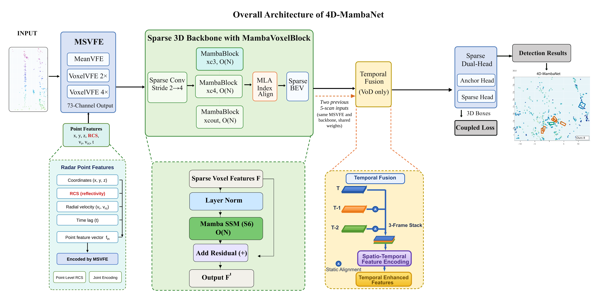

# 4D-MambaNet

[](LICENSE)
[](docs/INSTALL.md)
[](docs/INSTALL.md)
[](docs/INSTALL.md)

**4D-MambaNet: Mamba State Space Models for Sparse 4D Radar 3D Object Detection**

**News:** 2026-11: code, configs and checkpoints released.

## Highlights
- **MambaVoxelBlock**: processes all non-empty voxels of a radar frame as one sequence with a selective state space model (Mamba), providing sequence-level context aggregation beyond fixed-size local patches at a cost linear in the number of voxels.
- **RCS as a point feature**: we analyze where the radar cross-section (RCS) should enter the network; encoded as a point feature, it improves mAP by 1.5 in every seed.
- **Radar-only state of the art on View-of-Delft**: 56.08 ± 0.19 mAP over four seeds, with gains over a same-protocol baseline in every seed; 34.60 ± 0.57 mAP_3D on TJ4DRadSet.
- **Efficient**: about 1.4× faster end to end than the baseline (10.36 FPS on an RTX 3090) with fewer parameters executed at inference.
- **Reproducible**: configs for every experiment in the paper, checkpoints for all seeds, per-epoch logs and the statistical analysis scripts (paired t-tests over four seeds).

## Verify our results in 15 minutes

1. Summarize per-epoch logs (no GPU):

```bash
python tools/analysis/summarize_seeds.py
```

Expected: 4D-MambaNet **56.08 ± 0.19** (R11); vs. M3-Net repro **+1.43** (p=0.059), R40 **+1.55** (p=0.017).

2. Download and verify release weights:

```bash
export RELEASE_URL=https://github.com/sheraz007/4D-MambaNet/releases/download/v1.0
bash tools/scripts/download_checkpoints.sh && \
  (cd checkpoints && sha256sum -c ../checkpoints.sha256)
```

3. Evaluate VoD 4D-MambaNet seed 0 at paper batch size 8:

```bash
bash tools/scripts/eval_checkpoint.sh cfgs/vod/4d_mambanet.yaml \
  checkpoints/vod_4d_mambanet_seed0_ep78_weights.pth 0 8
```

Expected R11 **56.226** (other seeds: 56.156 / 56.154 / 55.797).



## Method
4D radar point clouds are sparse, noisy and unevenly distributed. In such scans, local patch attention has to group voxels over large regions, mixing different objects and background, and its attention becomes nearly uniform. 4D-MambaNet replaces patch attention in the sparse 3D backbone with MambaVoxelBlock, which processes the non-empty voxels of each frame as one sequence (Eq. F' = F + MambaSSM(LN(F)), applied at the stages x_c3, x_c4 and x_cout), and uses RCS as a point feature encoded jointly with the coordinates, velocities and time lag.


## Main results (VoD val, four seeds, mean ± std)

Paper tables use **training-time evaluation with batch size 8**. Corridor mAP is the VoD **driving-corridor** AP (restricted lateral/forward region defined by the VoD evaluation protocol).

| Model | R11 mAP (best) | R40 mAP (best) | Corridor mAP (R11) |
|---|---|---|---|
| Radar M3-Net (repro.) | 54.65 ± 0.88 | 52.35 ± 0.55 | 70.65 ± 0.50 |
| 4D-MambaNet w/o RCS input | 54.59 ± 0.84 | 52.29 ± 0.49 | 71.18 ± 0.17 |
| **4D-MambaNet** | **56.08 ± 0.19** | **53.91 ± 0.20** | **72.88 ± 1.20** |

Per-seed 4D-MambaNet R11 (bs=8): 56.226 / 56.156 / 56.154 / 55.797.

| TJ4DRadSet (best) | mAP_3D | mAP_BEV |
|---|---|---|
| Radar M3-Net (repro.) | 33.53 ± 0.41 | 38.87 ± 0.83 |
| **4D-MambaNet** | **34.60 ± 0.57** | **39.63 ± 0.30** |

Runtime: **11.14 ± 0.26 FPS** (network) / **10.36 ± 0.44 FPS** (end-to-end) on RTX 3090; 14.73 M params built, 10.30 M executed.

## Comparison with published radar-only methods (VoD val)

| Method | Car | Ped. | Cyc. | mAP | Car (C) | Ped. (C) | Cyc. (C) | mAP (C) |
|---|---|---|---|---|---|---|---|---|
| RPFA-Net | 33.45 | 26.42 | 56.34 | 38.75 | 68.68 | 34.25 | 80.36 | 62.44 |
| MVFAN | 34.05 | 27.27 | 57.14 | 39.42 | 69.81 | 38.65 | 84.87 | 64.38 |
| PillarNeXt | 32.04 | 26.85 | 61.06 | 39.98 | – | – | – | – |
| CenterPoint | 35.84 | 41.03 | 67.11 | 47.99 | 70.65 | 50.14 | 85.67 | 68.82 |
| VoxelNeXt | 36.98 | 42.37 | 68.15 | 49.17 | 70.95 | 51.85 | 87.33 | 70.04 |
| PointPillars | 42.19 | 39.29 | 66.66 | 49.38 | 71.59 | 50.67 | 85.23 | 69.16 |
| MUFASA | 43.10 | 38.97 | 68.65 | 50.24 | 72.50 | 50.28 | 88.51 | 70.43 |
| RadarNeXt | 37.44 | 41.83 | 72.16 | 50.48 | – | – | – | – |
| RadarPillars | 41.10 | 38.60 | 72.60 | 50.70 | 71.10 | 52.30 | 87.90 | 70.50 |
| SMURF | 43.31 | 39.09 | 71.50 | 50.97 | 71.74 | 50.54 | 86.87 | 69.72 |
| RadarGaussianDet3D | – | – | – | 52.0 | – | – | – | – |
| MAFF-Net | – | – | – | 54.6 | – | – | – | – |
| Radar M3-Net | 41.65 | 49.10 | 76.70 | 55.81 | 71.89 | 53.65 | 88.40 | 71.31 |
| **4D-MambaNet (mean of 4 seeds)** | **42.72** | **49.22** | **76.31** | **56.08 ± 0.19** | **77.87** | **53.25** | **87.53** | **72.88 ± 1.20** |
| **4D-MambaNet (best seed)** | **42.98** | **49.37** | **76.33** | **56.23** | **79.80** | **53.45** | **87.71** | **73.65** |

AP in %; (C): driving corridor. Published results are taken from the respective papers (single runs); PillarNeXt as reported by RadarNeXt. Radar–camera fusion methods are listed in the paper (e.g., LXL: 56.31 mAP).

**Note:** seed-to-seed variance on VoD is about **0.2–0.9 mAP (R11)**; always compare means over seeds 0–3.

Note on the Radar M3-Net baseline: its PTv3 stage uses a random serialization order also at inference (shuffle_orders=True). Because R11 samples precision at only 11 recall points, repeated evaluations of the same checkpoint can change R11 noticeably for some seeds (in our re-evaluation by up to about 2 mAP). The paper reports the training-time evaluation (best epoch) for all models; a lower re-evaluated baseline only increases the gain. 4D-MambaNet does not use PTv3 and gives identical results in every evaluation.

### Batch size 1 reference (same checkpoints)

For debugging or single-GPU sanity checks you may evaluate with `--batch_size 1`. Numbers differ slightly from the paper (bs=8) tables:

| Model | Seed 0 | Seed 1 | Seed 2 | Seed 3 | Mean R11 / R40 |
|---|---|---|---|---|---|
| 4D-MambaNet | 56.235 / 54.066 | 56.222 / 54.036 | 56.152 / 53.979 | 55.830 / 53.636 | 56.11 / 53.93 |
| M3-Net repro | 55.197 / 52.709 | 51.864 / 51.255 | 52.568 / 51.684 | 55.104 / 52.655 | 53.68 / 52.08 |

R11 is sensitive near the maximum recall of a class, so results with batch size 1 and 8 differ slightly; the gain of 4D-MambaNet holds under both.

Full tables: [`results/expected_results.md`](results/expected_results.md).

## Model zoo

Weights-only checkpoints (GitHub Release [v1.0](https://github.com/sheraz007/4D-MambaNet/releases/tag/v1.0)):

| Asset | Link |
|---|---|
| VoD 4D-MambaNet seed0 (ep78) | [download](https://github.com/sheraz007/4D-MambaNet/releases/download/v1.0/vod_4d_mambanet_seed0_ep78_weights.pth) |
| VoD 4D-MambaNet seed1 (ep79) | [download](https://github.com/sheraz007/4D-MambaNet/releases/download/v1.0/vod_4d_mambanet_seed1_ep79_weights.pth) |
| VoD 4D-MambaNet seed2 (ep80) | [download](https://github.com/sheraz007/4D-MambaNet/releases/download/v1.0/vod_4d_mambanet_seed2_ep80_weights.pth) |
| VoD 4D-MambaNet seed3 (ep71) | [download](https://github.com/sheraz007/4D-MambaNet/releases/download/v1.0/vod_4d_mambanet_seed3_ep71_weights.pth) |
| VoD M3-Net repro seed0 (ep78) | [download](https://github.com/sheraz007/4D-MambaNet/releases/download/v1.0/vod_m3net_seed0_ep78_weights.pth) |
| VoD M3-Net repro seed1 (ep61) | [download](https://github.com/sheraz007/4D-MambaNet/releases/download/v1.0/vod_m3net_seed1_ep61_weights.pth) |
| VoD M3-Net repro seed2 (ep73) | [download](https://github.com/sheraz007/4D-MambaNet/releases/download/v1.0/vod_m3net_seed2_ep73_weights.pth) |
| VoD M3-Net repro seed3 (ep73) | [download](https://github.com/sheraz007/4D-MambaNet/releases/download/v1.0/vod_m3net_seed3_ep73_weights.pth) |
| TJ4D 4D-MambaNet seed0 (ep71) | [download](https://github.com/sheraz007/4D-MambaNet/releases/download/v1.0/tj4d_4d_mambanet_seed0_ep71_weights.pth) |
| TJ4D 4D-MambaNet seed1 (ep74) | [download](https://github.com/sheraz007/4D-MambaNet/releases/download/v1.0/tj4d_4d_mambanet_seed1_ep74_weights.pth) |
| TJ4D 4D-MambaNet seed2 (ep76) | [download](https://github.com/sheraz007/4D-MambaNet/releases/download/v1.0/tj4d_4d_mambanet_seed2_ep76_weights.pth) |
| TJ4D 4D-MambaNet seed3 (ep58) | [download](https://github.com/sheraz007/4D-MambaNet/releases/download/v1.0/tj4d_4d_mambanet_seed3_ep58_weights.pth) |
| SHA256 sums | [checkpoints.sha256](https://github.com/sheraz007/4D-MambaNet/releases/download/v1.0/checkpoints.sha256) |

Or: `export RELEASE_URL=https://github.com/sheraz007/4D-MambaNet/releases/download/v1.0 && bash tools/scripts/download_checkpoints.sh`. Details: [`docs/MODEL_ZOO.md`](docs/MODEL_ZOO.md).

## Quick start

1. **Install** — [`docs/INSTALL.md`](docs/INSTALL.md) (Python 3.10, torch 2.5.1+cu121, spconv 2.3.8, mamba-ssm **2.3.1**).
2. **Data** — [`docs/DATA.md`](docs/DATA.md) (VoD 5-scan + TJ4D under `data/`).
3. **Getting started** — [`docs/GETTING_STARTED.md`](docs/GETTING_STARTED.md).
4. **Train (4 seeds)** — `bash tools/scripts/train_4seeds.sh cfgs/vod/4d_mambanet.yaml 0`
5. **Eval (paper protocol, batch size 8)** —

```bash
cd tools
python test.py --cfg_file cfgs/vod/4d_mambanet.yaml \
  --batch_size 8 --workers 4 \
  --ckpt ../checkpoints/vod_4d_mambanet_seed0_ep78_weights.pth
```

Expected VoD seed 0 epoch 78: **R11 ≈ 56.226**. See [`docs/REPRODUCE.md`](docs/REPRODUCE.md).

Training follows the submitted implementation, in which the active voxels of all samples in a mini-batch form one Mamba sequence. Per-frame training is available (PER_FRAME_SEQUENCE=True); in the paper (Sec. 4.5.1) both settings gave statistically indistinguishable results.

## Acknowledgements

This repository is based on [OpenPCDet](https://github.com/open-mmlab/OpenPCDet) and builds on [Radar M3-Net](https://doi.org/10.1016/j.eswa.2025.127515). See [`NOTICE`](NOTICE), [`LICENSE`](LICENSE) and [`THIRD_PARTY_NOTICES.md`](THIRD_PARTY_NOTICES.md).

